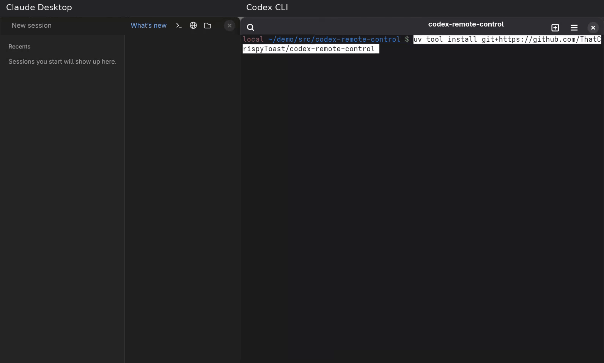

# codex-remote-control

Open a local Codex thread in the Claude app or at [claude.ai/code](https://claude.ai/code).
Send a prompt from your phone, watch Codex run commands on your machine, and
review diffs and approval requests in the chat. The app's Changes and Files
panels, file mentions, attachments and side chat work on the thread's directory.



## Quickstart

You need the [Codex CLI](https://github.com/openai/codex) (0.170 or later) and
Claude Code on the same machine. Run `claude`, sign in with `/login`, then quit.

1. Install the bridge with [uv](https://docs.astral.sh/uv/).

   ```sh
   uv tool install git+https://github.com/ThatCrispyToast/codex-remote-control
   ```

2. At the Codex prompt, enter `!codex-rc`.

3. Open the link Codex prints, or select the session under **Remote Control**
   in your Claude account.

If Codex can't find `codex-rc`, run `uv tool update-shell`. For pipx, use
`pipx install git+https://github.com/ThatCrispyToast/codex-remote-control`.

## Managing a session

The default session title is `Codex: <thread name>`, or `Codex: <directory>`
for an unnamed thread. Run `!codex-rc My Project` to set a name that survives
reconnects. A new session includes up to 30 turns of history. A session you
reconnect catches up on the turns you ran in the terminal meanwhile.

You can close the Codex terminal and keep working from Claude. To rejoin from
the terminal, use `codex resume`. Both show the same thread, and you can answer
an approval in either one.

Run `!codex-rc --stop` inside Codex to disconnect. Running `!codex-rc` again
reopens the same Remote Control session and prints its link. Archiving the
session in Claude stops the bridge. The next connection creates a new session.

### From a shell

`codex-rc` runs in the foreground until you press Ctrl-C.

```sh
codex-rc --last                  # Use this directory's most recent thread
codex-rc --thread <thread-id>    # Use a specific thread
codex-rc                         # Start a thread in this directory
codex-rc -C ~/project My Project # Start a named session in another directory
```

The command prints the session URL and the `codex resume` command for the thread.
Use `-m MODEL` to choose a model for a new thread or `-v` for verbose logs.

`codex-rc --list` shows the threads on Remote Control from this machine.
`codex-rc --stop` stops the only one, or the one you name with `--thread <thread-id>`.

## Controls in Claude

Send another message during a turn to steer it. **Stop** interrupts the turn,
though a shell command Codex already started can keep running. The context
meter shows the thread's token usage.

Attach files to a message and Codex gets them as local files. Type `@` to
mention a file from the thread's directory. The **Files** panel browses and
opens them, and the **Changes** panel shows the working tree's diff when the
directory is a checkout of a GitHub repository.

An approval request appears as a card with **Deny** and **Allow once**. A
command's card also offers **Always allow**, which approves that exact command
for as long as the thread stays on Remote Control.

The model picker lists Claude models and shows “Unsupported model” for Codex.
Type these in the chat box instead. The app's own `/usage` card shows your
Claude plan's limits, so `/codex` shows Codex's.

| Command | Action |
| --- | --- |
| `/model <id>` | Change the Codex model |
| `/effort [level]` | Show or change reasoning effort |
| `/compact` | Compact the thread's context |
| `/review [instructions]` | Review the uncommitted changes, or what you describe |
| `/codex` | Show the Codex model and the others on offer, sandbox, context, usage limits and thread id |
| `/sandbox` | Show the sandbox and approval settings |
| `/btw <question>` | Ask a side question without adding to the thread |

Other slash commands the app passes along are answered with this list. They
are never sent to the model as a prompt.

The mode menu starts at the closest match to your Codex settings.

| Claude mode | Codex behavior |
| --- | --- |
| Manual | Read-only. Asks before writing. |
| Accept edits | Can edit the workspace. Asks before working outside it. |
| Auto | Same workspace access. The Codex reviewer handles approval requests. |
| Plan | Plans changes without editing files. |

## Compatibility

This is an unofficial integration. It uses Anthropic's private Remote Control
protocol and the experimental Codex app-server API. Tested with Codex 0.170.0
and claude.ai/code on 2026-11-18.

- **“Already has an active writer”** means the Codex session has its own
  app-server. Start Codex without `-c`, `--enable`, `--disable` or `--search`
  so the bridge can join it.
- An MCP tool's request to run, and an MCP form made only of choices, appear
  in Claude. Answer a form with text fields in the Codex terminal.
- Rewind, file undo, forks, and adding MCP servers from Claude are unsupported.
- `/review` and `/btw` use your Codex plan like any other turn.
- If the Codex daemon restarts mid-turn, the bridge reconnects. The interrupted
  turn ends with an error.

## Development

The bridge connects the shared Codex app-server to a Remote Control worker
from [claude-rc-api](https://github.com/ThatCrispyToast/claude-rc-api).
[bridge.py](codex_remote_control/bridge.py) handles session events,
[translate.py](codex_remote_control/translate.py) turns Codex commands, edits,
and approval requests into Claude transcript entries and permission cards, and
[workspace.py](codex_remote_control/workspace.py) answers the app's Changes and
Files panels from the thread's directory.

Each thread has one bridge. Its lock file, its background log and the files
attached to its messages live under `$XDG_STATE_HOME/codex-remote-control/`,
which defaults to `~/.local/state/codex-remote-control/`.

```sh
git clone https://github.com/ThatCrispyToast/codex-remote-control
cd codex-remote-control
uv run --extra test pytest -q
uv run codex-rc --help
```
